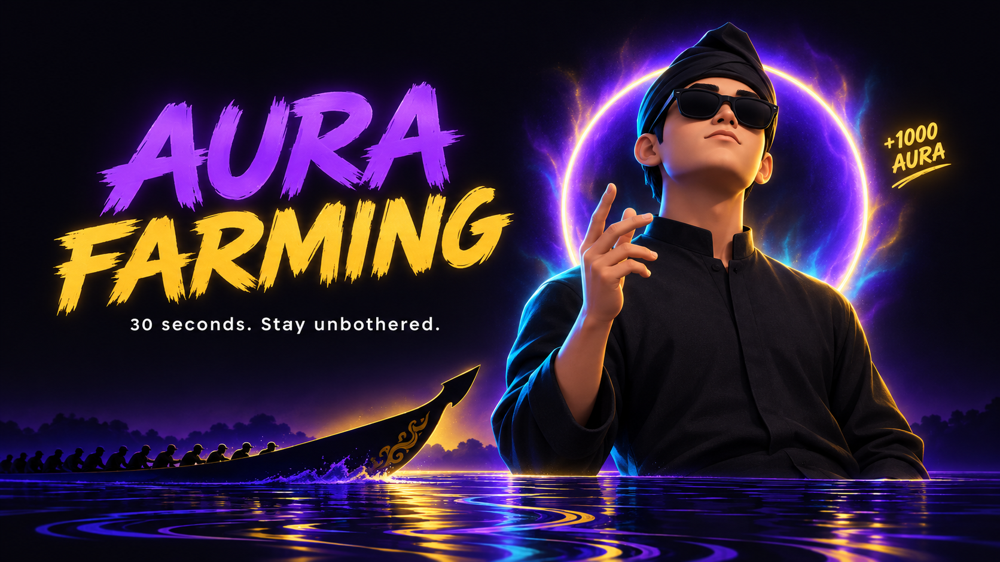
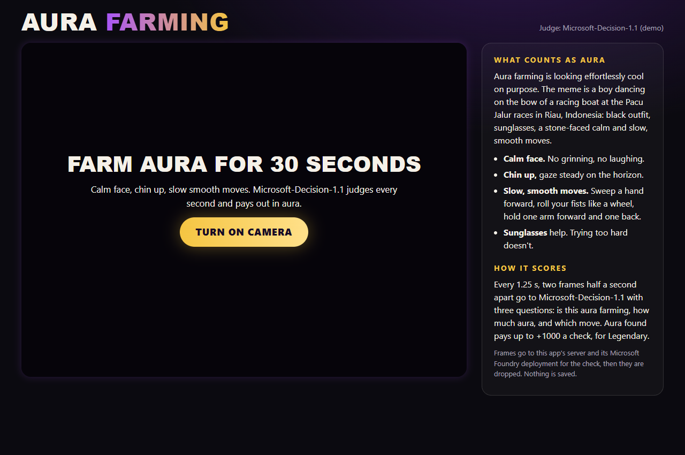
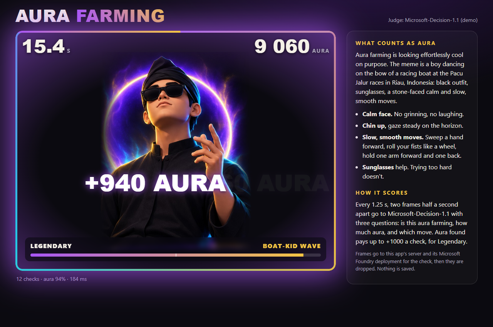
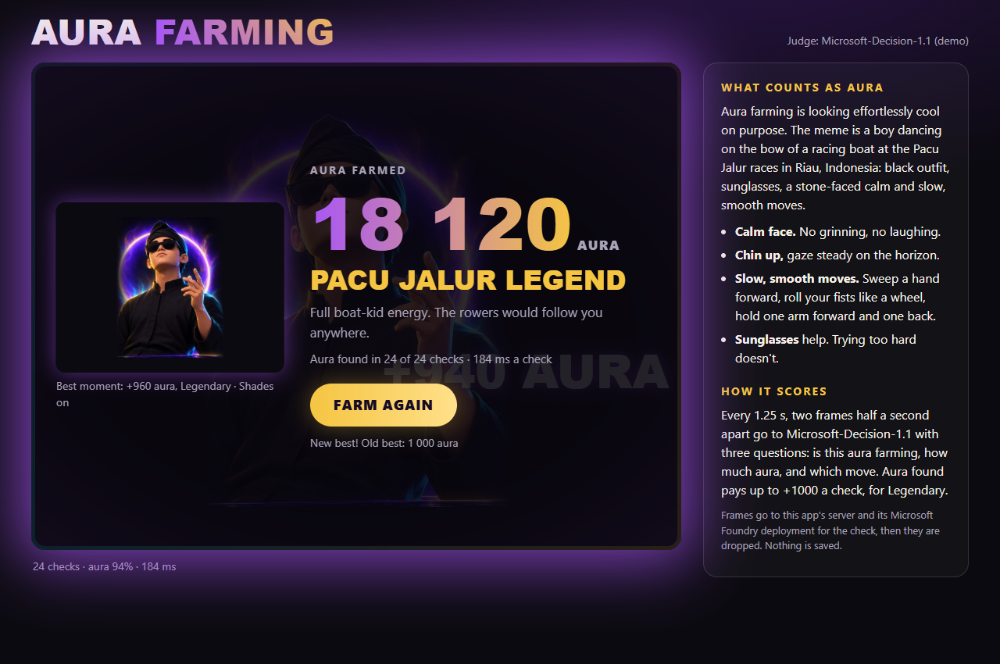

# Aura Farming



A 30-second webcam game. Microsoft-Decision-1.1 on Microsoft Foundry watches you and pays out in aura when you farm it
like the Pacu Jalur boat kid: calm face, chin up, sunglasses, slow and smooth moves.

`azd up` creates everything it needs: its own Microsoft-Decision-1.1 deployment, an App Service to host the game, and a
managed identity that connects the two. There are no keys to manage.

## Features

The screenshots show the real app UI with an illustrated demo camera and example verdicts, not real webcam frames or
model evaluations. The splash artwork is AI-generated.

### Camera setup and aura guide

Turn on your camera and learn which expressions, poses and moves earn aura.



### Live aura scoring

A 30-second timer, running total, confidence meter, recognized moves, glowing camera border and floating aura payouts.



### Round results and personal best

See your total, rank, best-moment snapshot and check statistics, then farm again to beat your locally saved best.



## What counts as aura

[Aura farming](https://en.wikipedia.org/wiki/Aura_farming) is looking effortlessly cool on purpose. The term took off in
2025 with a video of a boy dancing on the bow of a racing boat at the Pacu Jalur races in Riau, Indonesia. He wears a
black traditional outfit, a headcloth and sunglasses, keeps a nearly expressionless face, and repeats slow moves: a hand
sweeping forward, fists rolling like a wheel, one arm forward and one back.

[lib/aura.js](lib/aura.js) gives the model that definition, plus what shows aura and what loses it:

- **Aura:** a calm or blank face, chin up, a steady upright posture, a steady gaze, slow controlled gestures, sunglasses.
- **No aura:** laughing or grinning, pulling faces, looking down at a phone, slouching, frantic moves, nobody in view.

The model is told to judge pose, expression, gaze, gestures and props only, never the person's looks.

## How it works

Every 1.25 s the page grabs two webcam frames, half a second apart so movement shows, and posts them to the server. The
server checks they are JPEGs the model accepts, then asks Microsoft-Decision-1.1 three questions in one request. The
frames go in the request's `assets` and the state refers to them as `image:frame1.jpg` and `image:frame2.jpg`.

| Question | Type | Answers | Used for |
| --- | --- | --- | --- |
| Is the player aura farming? | `noul` | a probability | Aura is found at 0.5 or more |
| How much aura? | `score` | No aura, A trace, Some aura, Main character, Legendary | The points |
| What is the player doing? | `choice` | Boat-kid wave, Arm forward, Unbothered stare, Shades on, Trying too hard, No aura, Can't tell | The live read |

A check pays `250 × level × probability`, rounded to 10, and only when aura is found. Certain Legendary aura is the
meme's "+1000 aura". A round makes about 24 checks, and the total sets your rank:

| Aura | Rank |
| --- | --- |
| 0 | NPC |
| 1 to 1,999 | Background character |
| 2,000 | Side character |
| 5,000 | Main character |
| 9,000 | Aura farmer |
| 14,000 | Pacu Jalur legend |

The live overlay shows the model's latest read. The glow round the camera follows the probability, the bar marks the 0.5
line, and each check that finds aura floats up as `+N aura`. The results show your best moment.

The browser only sends pictures. The server writes everything the model reads, so a page can't slip its own text or
questions in front of it.

## Deploy to Azure

You need the [Azure Developer CLI](https://aka.ms/azd) (1.18 or later) and an Azure subscription.

```sh
azd auth login
azd up
```

azd asks for an environment name, a subscription and a region. It only offers regions with enough Microsoft-Decision-1.1
quota. It then creates `rg-<environment>`:

| Resource | What it does |
| --- | --- |
| Microsoft Foundry account (`AIServices`, key auth off) | Hosts the model |
| `decision-1.1`: Microsoft-Decision-1.1, GlobalStandard, capacity 1000 | The judge |
| User-assigned managed identity with Cognitive Services User on the Foundry account | Lets the app call the model without keys |
| App Service plan (P0v3, Linux) and web app (Node 24 LTS, HTTPS only) | Serves the game. Browsers only allow the camera over HTTPS |

You get Cognitive Services User on the Foundry account too, so a local `npm start` can use the same deployment.

Change the defaults with `azd env set` before `azd up`:

| Setting | Default | Notes |
| --- | --- | --- |
| `APP_SERVICE_SKU` | `P0v3` | A dedicated vCPU and 4 GB |
| `DECISION_SKU` | `GlobalStandard` | `DataZoneStandard` keeps processing in the US or EU data zone |
| `DECISION_CAPACITY` | `1000` | 1 request and 1,000 tokens a minute per unit. A player uses 48 checks and about 56,000 tokens a minute, so 1000 serves about 17 players at once |

**Cost.** The P0v3 plan is about $57 to $70 a month depending on the region, and it bills whether or not anyone plays.
The model costs $0.04 per million input tokens. A check is about 1,160 tokens, so a round costs about $0.001. The server
stops after `DAILY_CALL_LIMIT` checks a day (20,000 by default, about $0.93). `azd down --purge` removes everything.

## Run it locally

Use Node 22 or later, and sign in to the Azure CLI with `az login`. After `azd up`:

```sh
azd env get-values > .env
npm start
```

In Windows PowerShell 5.1, `>` writes UTF-16, which Node can't read. Use `azd env get-values | Set-Content .env` there.

Open <http://127.0.0.1:8742>. Browsers allow the camera on localhost without HTTPS. To use another Microsoft-Decision-1.1
deployment instead, copy [.env.example](.env.example) to `.env` and fill it in.

## Privacy

Each check sends two frames from the browser to this app's server, and from there to your Foundry deployment. The server
never writes frames to disk or logs them. The best-moment picture stays in the browser, and only your best score is saved
there, in local storage.

## Configuration

| Variable | Default | |
| --- | --- | --- |
| `FOUNDRY_ENDPOINT` | | The Foundry endpoint. Without it the page loads, but checks return 503 |
| `FOUNDRY_DEPLOYMENT` | `decision-1.1` | |
| `FOUNDRY_API_KEY` | | Key auth instead of Entra ID. The azd deployment has keys turned off |
| `PORT`, `HOST` | `8742`, `127.0.0.1` | App Service sets `PORT`, and the infra sets `HOST=0.0.0.0` |
| `DAILY_CALL_LIMIT` | `20000` | Checks a day before the server answers 429 |
| `LOG_DECISIONS` | | `1` logs each verdict: numbers only, never frames |

## Tests

`npm test` runs the node:test suites. A fake Foundry endpoint stands in for the model, so they make no model calls.
